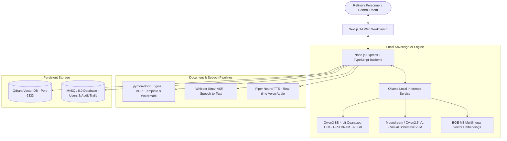

<div align="center">

# Pragya AI (प्रज्ञा AI)
### Sovereign AI Workbench for Mangalore Refinery and Petrochemicals Limited (MRPL)

[](#architecture--model-stack)
[](#hardware-specifications)
[](#security--governance)
[](#zero-cloud-egress-guarantee)

**A 100% self-hosted, air-gapped enterprise AI platform tailored for the mission-critical operations of Mangalore Refinery and Petrochemicals Limited (MRPL - A Subsidiary of ONGC).**

[Overview](#overview) • [Key Capabilities](#key-capabilities) • [Architecture](#architecture--model-stack) • [Quick Start](#quick-start-guide) • [Deliverables & Word Engine](#automated-deliverables--word-generation) • [Default Credentials](#default-credentials)

</div>

---

## Overview

**Pragya AI** is a sovereign engineering workbench designed to operate entirely within MRPL's local network perimeter without external cloud dependencies. Tailored for chemical engineers, inspection auditors, turnaround planners, and control room operators, the platform enables:

1. **Grounded SOP & Technical Retrieval (RAG):** Query refinery Standard Operating Procedures, ASME Section VIII Boiler codes, API 510/570/653 standards, and catalyst manuals with dense vector search (BGE-M3).
2. **P&ID Diagram & Ultrasonic NDT Vision:** Visual deconstruction of Piping & Instrumentation Diagrams, ISA-5.1 control loops, and ultrasonic thickness measurement scan sheets using local Vision VLMs.
3. **Automated Deliverables (`.docx` / `.xlsx` / `.pdf`):** Instant compilation of formal MRPL-branded deliverables, Executive Board Approval Notes, and turnaround memos using `python-docx` with custom letterhead, metadata grid, and light centered watermarks.
4. **Hands-Free Speech Interaction:** Whisper Small speech-to-text (ASR) and Piper neural voice text-to-speech (TTS) for audible checklist readouts in refinery control rooms.
5. **Role-Based Governance & Audit Logging:** Enterprise admin approval gates, permission hierarchies (Admin, Engineer, Auditor, Analyst), and tamper-evident audit trails.

---

## Architecture & Model Stack

The workbench is optimized to run locally on a dedicated **6.0 GB VRAM GPU budget** (NVIDIA GeForce RTX 3050 Laptop GPU / 16GB System RAM):



### Model Specifications

| No. | Model / Engine | Category | Primary Role | Memory & Execution Profile |
| :--- | :--- | :--- | :--- | :--- |
| **1** | **Qwen3-8B (4-bit Quantized)** | Central Reasoning LLM | RAG synthesis, technical compliance, calculations & report writing | **~4.8 GB VRAM** (RTX 3050 GPU) |
| **2** | **Moondream / Qwen2.5-VL** | Vision-Language Model | Deconstructs P&ID diagrams, ISA-5.1 loops & NDT curves | **~1.7 GB RAM/VRAM** (On-Demand) |
| **3** | **BGE-M3** | Dense Text Embeddings | Multilingual 1024-D dense vector search for Qdrant vector store | **CPU / FastEmbed** (~0.8 GB RAM) |
| **4** | **Whisper Small** | Speech-to-Text (ASR) | Hands-free plant voice query transcription | **CPU Multiprocessing** (~0.8 GB RAM) |
| **5** | **Piper Neural TTS** | Text-to-Speech (TTS) | Local neural voice synthesis for SOP checklists & alerts | **ONNX Runtime CPU** (~0.15 GB RAM) |
| **6** | **python-docx Engine** | Document Processing | Compiles formatted Word documents with MRPL letterhead & watermarks | **Native Python 3.11** |

---

## Automated Deliverables & Word Generation

Whenever users ask to generate reports, approval notes, or compliance deliverables (or click the **`Word (.docx)`** button on any message), the platform uses `python-docx` to compile an authenticated `.docx` file containing:

- **MRPL Header Banner:** `MANGALORE REFINERY AND PETROCHEMICALS LIMITED (MRPL) · A Subsidiary of ONGC` with clean division rule.
- **Clean Metadata Grid:** Displays Document Name, Timestamp, Author/User, Purpose/Use, and Security Classification.
- **Light Centered Watermark:** Subtly embedded diagonal `MRPL CONFIDENTIAL` watermark across all pages (`mso-position: center`).
- **Structured Data Tables:** Formatted measurement grids (e.g., Ultrasonic Wall Thickness, ASME compliance, operating pressure margins) with alternating zebra striping.
- **Clean Content Body:** Pure technical findings, bullet checklists, and action directives without redundant query echoes.

---

## Project Structure

```text
pragya-workbench/
├── backend/                        # Node.js Express + TypeScript Server
│   ├── src/
│   │   ├── config/                 # Database & Qdrant configuration
│   │   ├── controllers/            # Auth, chat, knowledge & AI controllers
│   │   ├── middleware/             # JWT auth & role-permission middleware
│   │   ├── routes/                 # AI, auth, chat, knowledge, task routes
│   │   ├── scripts/                # Python scripts (generate_docx.py, piper_tts.py, whisper_asr.py)
│   │   ├── services/               # localAi, docParser, vector, userStore services
│   │   └── server.ts               # Express application entry point
│   ├── data/                       # Local file-based user fallback store
│   ├── schema.sql                  # MySQL database schema & seeds
│   ├── package.json
│   └── tsconfig.json
├── frontend/                       # Next.js 14 React Workbench UI
│   ├── src/
│   │   ├── app/                    # Next.js App Router (pages & layout)
│   │   ├── components/             # FullWorkbenchView, AdminConsole, KnowledgeBase, etc.
│   │   └── context/                # AuthContext (Role management & sessions)
│   ├── public/                     # Static assets & icons
│   ├── package.json
│   └── tsconfig.json
├── sample_documents/               # Sample refinery SOPs, NDT scans & P&ID diagrams
├── PRD.md                          # Product Requirements Document
├── .gitignore                      # Git ignore rules (excludes models & large files)
└── README.md                       # Main documentation
```

---

## Quick Start Guide

### Prerequisites
- **Node.js:** v18.0 or higher
- **Python:** v3.10 or higher with `python-docx` installed (`pip install python-docx piper-tts faster-whisper`)
- **MySQL:** MySQL Server 8.0 running locally on port `3306`
- **Ollama:** Ollama local inference service installed and running on port `11434`
- **Qdrant (Optional):** Qdrant vector database running on port `6333`

---

### Step 1: Clone Repository
```bash
git clone https://github.com/chinmay56/pragya.git
cd pragya
```

---

### Step 2: Configure Database & Schema
1. Open your MySQL client and run the database initialization schema:
```bash
cd backend
npm install
npm run init-db
```
*(Or import `backend/schema.sql` directly into MySQL).*

2. Configure `backend/.env` with your database credentials:
```env
PORT=5000
NODE_ENV=development
DB_HOST=localhost
DB_PORT=3306
DB_USER=root
DB_PASSWORD=your_mysql_password
DB_NAME=pragya_ai
JWT_SECRET=pragya_super_secret_jwt_key_2026_airgapped
OLLAMA_URL=http://localhost:11434
QDRANT_URL=http://localhost:6333
```

---

### Step 3: Start Ollama Models
Ensure the required models are pulled and ready in your local Ollama instance:
```bash
ollama pull qwen3:8b
ollama pull bge-m3
ollama pull moondream
ollama serve
```

---

### Step 4: Run Backend & Frontend

#### Start Backend Server (Port 5000):
```bash
cd backend
npm run dev
```

#### Start Frontend Workbench (Port 3000):
```bash
cd frontend
npm install
npm run dev
```

Open [http://localhost:3000](http://localhost:3000) in your browser to access the workbench.

---

## Default Credentials

The platform comes pre-seeded with local role-based accounts for testing:

| Role | Username | Email | Password | Access Level |
| :--- | :--- | :--- | :--- | :--- |
| **System Administrator** | `admin` | `admin@pragya.internal` | `admin123` | Full Admin Console, User Approvals, Hardware Telemetry, Vector Knowledge Base |
| **Lead Process Engineer** | `chinmay` | `chinmay@enterprise.internal` | `admin123` | Interactive Workbench, SOP RAG, Document Deliverable Generation |
| **Process Analyst** | `rajesh` | `rajesh.analyst@enterprise.internal` | `admin123` | Standard Workbench Access |
| **Technical Auditor** | `priya` | `priya.audit@enterprise.internal` | `admin123` | Audit & Inspection Review |

---

## Security & Governance

- **Zero External Data Egress:** All model parameters, vector embeddings, and database records reside strictly on-premises.
- **ISO-27001 & OISD-156 Compliance:** Every generated Word document, prompt trace, and user action is logged with security classification banners.
- **Air-Gapped Operation:** Capable of running with network interfaces fully isolated from the public Internet.

---

## License & Attribution

Internal software developed for **Mangalore Refinery and Petrochemicals Limited (MRPL)**. All rights reserved.
